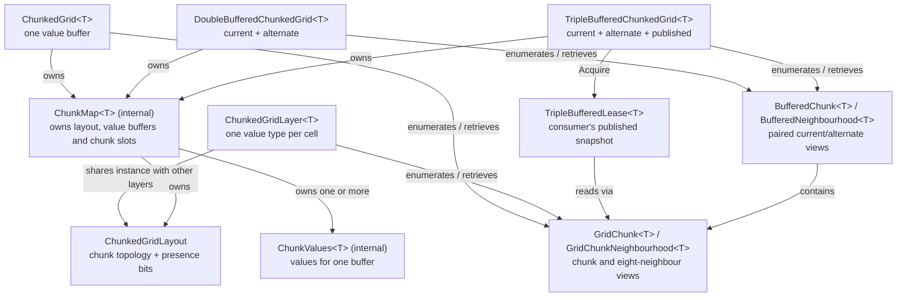

# Chunked grids

`Kiyote.Buffers.ChunkedGrids` stores sparse, two-dimensional data in square, power-of-two chunks allocated on demand. A presence bit distinguishes an occupied cell from an allocated cell containing its default value. Use a single grid for sparse maps, shared layers for several values with the same occupancy, and buffered grids for simulations that advance through successive states.

## How the classes fit together



`ChunkedGridLayout` tracks allocated chunk coordinates, cell presence, neighbours, and chunk indices, but **not values**. It accepts power-of-two chunk sizes from 1 to 4096. Multiple `ChunkedGridLayer<T>` instances can share the *same* layout while storing different value types; typed layers and grids additionally require a chunk size divisible by the `Vector256<T>` lane count. A layer observes layout allocations lazily and only `TrySet`/`GetReference` on populated cells can write by global coordinate; its chunk-value spans can also write unpopulated cells without changing presence.

`ChunkedGrid<T>`, `DoubleBufferedChunkedGrid<T>`, and `TripleBufferedChunkedGrid<T>` are **separate, self-contained** choices, not subclasses of each other or layers over a caller-supplied layout. Each owns an internal `ChunkMap<T>`, which keeps its layout and one or more value buffers synchronized. The public view and enumerator types expose chunks without making this internal storage part of the API.

## Choose a grid

| Need | Use | Typical operation |
| --- | --- | --- |
| One sparse value per populated cell | `ChunkedGrid<T>` | Read/write cells with the indexer; copy populated cells from another grid with `Attach` |
| Several independent values sharing one occupancy | `ChunkedGridLayout` with `ChunkedGridLayer<T>` instances | Set presence on the layout, then read/write corresponding populated cells in each layer |
| A simulation with previous and next states on one thread | `DoubleBufferedChunkedGrid<T>` | Read `GridBuffer.Alternate`, write `GridBuffer.Current` with `TrySet`, then `Swap()` |
| A simulation publishing states to one consumer thread | `TripleBufferedChunkedGrid<T>` | Write current, `Swap()` to publish; consumer `Acquire()`s and disposes a read-only lease |

For a sparse map:

```csharp
ChunkedGrid<float> grid = new();
grid[ 10, -3 ] = 1.5f; // Allocates the chunk and marks the cell populated.
if( grid.TryGet( 10, -3, out float value ) ) {
    // Use value.
}
grid.Clear( 10, -3 ); // Unpopulates the cell; Compact() can reclaim empty chunks.
```

For different values at the same locations:

```csharp
ChunkedGridLayout layout = new( 32 );
ChunkedGridLayer<float> temperature = new( layout );
ChunkedGridLayer<int> terrain = new( layout );
layout.SetPopulated( 10, 20 );
temperature.TrySet( 10, 20, 21.5f );
terrain.TrySet( 10, 20, 2 );
```

For a two-state update, populate the target once with `Attach` and then use its shared presence:

```csharp
ChunkedGrid<float> initial = new();
initial[ 0, 0 ] = 1f;
DoubleBufferedChunkedGrid<float> simulation = new();
simulation.Attach( initial, 0, 0 );
simulation.TryGet( 0, 0, GridBuffer.Alternate, out float previous );
simulation.TrySet( 0, 0, GridBuffer.Current, previous + 1f );
simulation.Swap();
```

`Attach` writes the current buffer and leaves the alternate value buffer at its previous/default value, so copy current to alternate first if both should initially hold the attached values. `Swap()` changes buffer roles, not the underlying storage; existing buffered chunk and neighbourhood views keep their original physical buffers. Get new views after a swap to see the new roles.

For concurrent publication, `TripleBufferedChunkedGrid<T>` uses the same current/alternate update pattern on its owning thread. `Swap()` publishes the newly written buffer; a **single** consumer obtains it with `using TripleBufferedLease<T> lease = simulation.Acquire();` and reads with `lease.TryGet` or `lease.EnumerateChunks()`. Dispose before acquiring again. Treat the lease and its views as read-only. Topology-changing or copy methods throw while leased, and callers must not change presence through previously obtained spans during a lease.

## Chunk access and helpers

- `GridChunk<T>` exposes a chunk's values and presence; `GridChunkNeighbourhood<T>` adds its eight adjacent chunks for stencil/halo operations. Missing neighbours read as unpopulated. `GetRowValues` and `GetPresenceRow` address the centre column's north/centre/south chunk, not corner rows.
- `BufferedChunk<T>` and `BufferedNeighbourhood<T>` pair current and alternate views of the **same presence**. `EnumerateChunks()` and `EnumerateNeighbourhoods()` provide allocation-free, ascending-index traversal. Do not allocate or remove chunks during enumeration; `MoveNext` and `Current` reject topology changes.
- `PresenceMask` expands presence bits into vector masks for SIMD processing. `ChunkPadding` and `GridChunkNeighbourhood<T>.CopyPadded` gather a chunk plus its halo into contiguous caller-provided storage.
- `ICellExtractor<TSource, TDestination>` customizes which source cells `Attach` copies and how values are converted. `HasOverlap` checks for populated collisions, `Detach` unpopulates matching cells, and `Compact` reclaims allocated-but-empty chunks. `Attach` does not allocate a destination chunk for an empty source chunk.

The layout and grid wrappers are not generally safe for unsynchronized topology/presence mutation across threads. The triple-buffer lease protocol is the specific supported concurrent read/publication path; coordinate lookup caches do not turn the other grid types into generally thread-safe collections.
